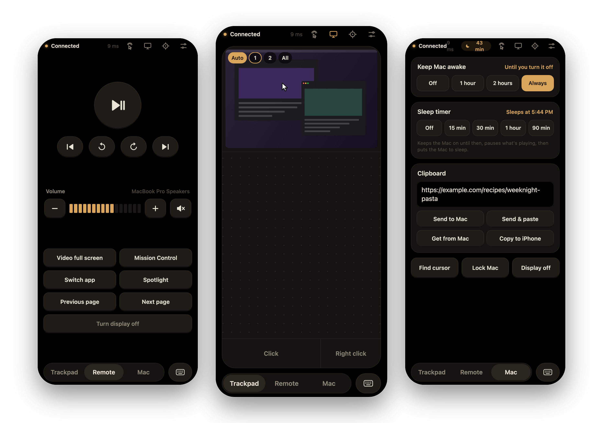
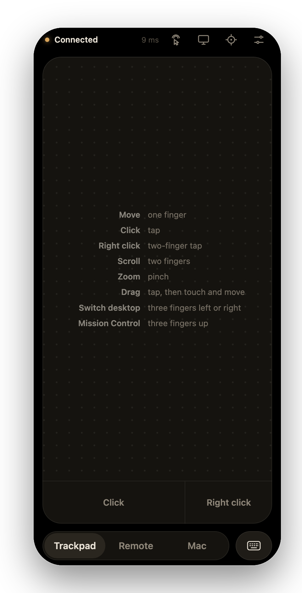
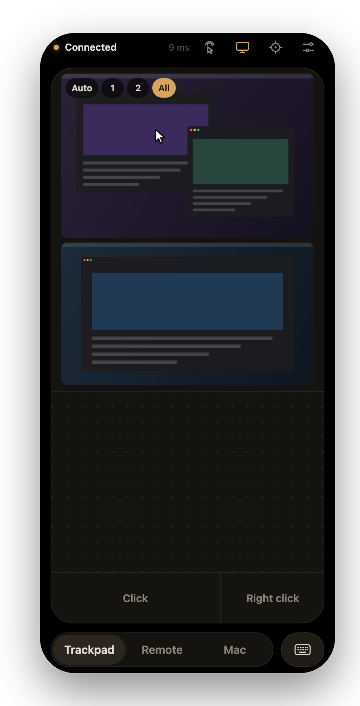
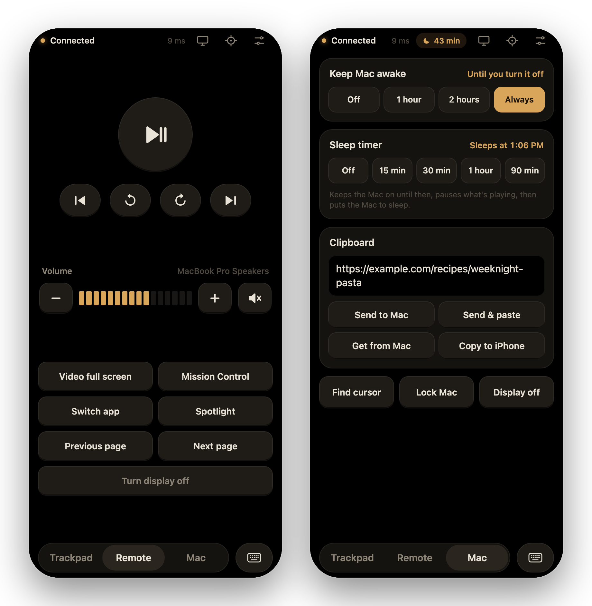
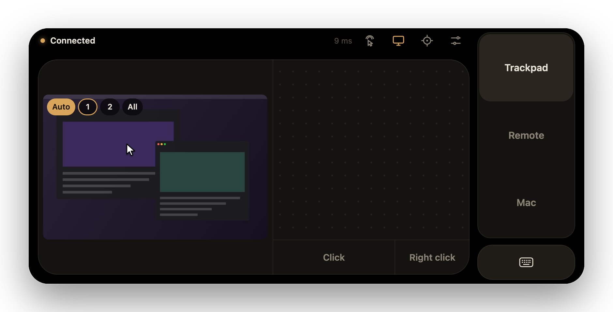

<p align="center">
  
</p>

<h1 align="center">Relay</h1>

<p align="center">
  <strong>Your iPhone as a trackpad, keyboard and remote for your Mac.</strong>
</p>

<p align="center">
  Drive a Mac from the sofa or from bed, over your own Wi-Fi.<br>
  Nothing to install on the phone, no account, no cloud. Just a small menu bar app and a page on your Home Screen.
</p>

<p align="center">
  <sub>macOS 14 or later on Apple silicon&nbsp;&nbsp;·&nbsp;&nbsp;iPhone with Safari&nbsp;&nbsp;·&nbsp;&nbsp;No dependencies&nbsp;&nbsp;·&nbsp;&nbsp;HTTPS and end-to-end encrypted</sub>
</p>

<p align="center">
  <a href="#get-started">Get started</a>&nbsp;&nbsp;·&nbsp;&nbsp;
  <a href="#features">Features</a>&nbsp;&nbsp;·&nbsp;&nbsp;
  <a href="#privacy-and-security">Privacy and security</a>&nbsp;&nbsp;·&nbsp;&nbsp;
  <a href="#development">Development</a>
</p>

<br>

<p align="center">
  
</p>

## Why Relay

Plug a Mac into a TV and the hardest part is the trackpad you left on the desk. Relay turns the phone already in your hand into a smooth, MacBook-style trackpad, a keyboard, and a remote with big buttons for whatever is playing.

It runs entirely between your own two devices. The Mac serves the phone page itself, so there is no app to install from the App Store, nothing to sign up for, and nothing hosted anywhere. Tap the icon on your Home Screen, and you're in control within a second.

## Features

**Trackpad that feels like a Mac.** Pointer acceleration modelled on macOS, 120 Hz motion pacing that smooths over Wi-Fi hiccups, tap to click, two-finger scrolling with momentum, tap-and-drag, pinch to zoom, and three- or four-finger swipes for desktops, Mission Control and App Exposé.

**A real keyboard.** The iPhone keyboard types straight into the Mac, including accents, emoji, dictation and predictive text. A row of extra keys adds esc, tab, arrows and sticky ⌃ ⌥ ⇧ ⌘ for shortcuts.

**A remote for the evening.** Play/pause, skip and volume use the Mac's own media keys, so they work with YouTube, Netflix, Music and Spotify alike. The volume meter shows the Mac's actual level and output device.

**See the screen.** A live preview of the Mac's screen sits above the trackpad. Tap anywhere on it to put the cursor there. With a TV or second display, Relay follows the screen your cursor is on.

**Mac controls.** Keep the Mac awake through a long film, set a sleep timer that pauses playback and sleeps the Mac, send a link from your phone to the Mac's clipboard (or back), find a lost cursor, lock the Mac, or turn the display off.

**Made to be left running.** Relay starts at login and sits in the menu bar. It uses no CPU while you're not touching the phone and never stops the Mac from sleeping on its own schedule.

## A closer look

<table>
  <tr>
    <td width="33%" valign="top">
      
      <p><strong>Trackpad.</strong> One finger moves, two scroll, three switch desktops. The tips fade after your first touch and can be brought back in Settings.</p>
    </td>
    <td width="33%" valign="top">
      
      <p><strong>Every screen, readable.</strong> Auto shows the screen your cursor is on at full width. All stacks your displays, and 1 or 2 pins one.</p>
    </td>
    <td width="33%" valign="top">
      
      <p><strong>Remote and Mac tabs.</strong> Big targets for media and volume, plus keep awake, sleep timer, clipboard and lock.</p>
    </td>
  </tr>
</table>

<p align="center">
  
</p>
<p align="center"><sub>Turn the phone sideways for a wide trackpad. There's also a one-handed layout for either hand in Settings.</sub></p>

<p align="center"><sub>Screenshots show the real phone interface, driven by a simulated Mac with made-up data (<a href="tools/screenshots">tools/screenshots</a>).</sub></p>

## Get started

You need:
- a Mac with Apple silicon running macOS 14 or later, with the Xcode command-line tools (`xcode-select --install`)
- an iPhone on the same Wi-Fi network

Relay doesn't have a downloadable release yet, so you build it from source. That takes about a minute.

**1. Install.** Download or clone this repository, then in Terminal, from its folder:

```bash
./scripts/install.sh
```

This builds Relay, installs it to `~/Applications/Relay.app`, and starts it now and at every login. A dot-grid icon appears in your menu bar.

**2. Allow access.** macOS asks for two permissions the first time:
- **Accessibility**, so Relay can move the cursor and type. Turn on Relay in System Settings › Privacy & Security › Accessibility.
- **Incoming connections**, when the iPhone first connects. Click **Allow**.

**3. Pair your iPhone.**

```bash
./scripts/pair.sh
```

This opens the pairing page on the Mac (or choose **Show Pairing Code…** from the menu bar icon). It has two steps:

1. **Trust this Mac (once).** Relay talks to your iPhone over HTTPS, using a certificate it creates for your Mac. Get it onto the iPhone:
   - **Recommended:** choose **Send Certificate to iPhone…** from the menu bar icon and pick your iPhone in AirDrop.
   - **No AirDrop?** Scan the first QR code to download it, and before trusting it, check that its fingerprint in iPhone Settings matches the one on the pairing page.

   Then on the iPhone, open **Settings › Profile Downloaded › Install**, and turn it on under **Settings › General › About › Certificate Trust Settings**.
2. **Open Relay.** Scan the second QR code, then in Safari tap **Share › Add to Home Screen**. The icon pairs itself.

From then on, tap **Relay** on your Home Screen. That's it.

> [!TIP]
> Had Relay on your Home Screen before it used HTTPS? Opening the old icon now shows the setup steps. Once the certificate is trusted, add Relay to the Home Screen again from the second QR code and delete the old icon.

> [!NOTE]
> The screen preview needs one more permission the first time you open it: **Screen & System Audio Recording**. Turn on Relay there, then choose **Restart Relay** from the menu bar icon.

<details>
<summary><strong>Gestures and controls</strong></summary>

<br>

| Gesture | Action |
|---|---|
| One finger | Move the cursor |
| Tap / tap twice | Click / double-click |
| Tap, then touch again and move | Drag |
| Two fingers | Scroll, with momentum on a flick |
| Two-finger tap | Right-click |
| Pinch | Zoom in or out (⌘+ / ⌘−) |
| Three or four fingers left / right | Switch desktop or full-screen app |
| Three or four fingers up / down | Mission Control / App Exposé |
| Hold **Click** and move with another finger | Long drags |

- **Keyboard:** tap the keyboard button. Tap a modifier for the next key only, or double-tap it to lock it. Shortcuts use US key positions; typed text works with any layout.
- **Remote:** play/pause, previous/next, skip back/forward (hold to repeat), volume and mute, plus Video full screen, Mission Control, Switch app, Spotlight, Previous/Next page and Turn display off. If your TV controls its own volume over HDMI, the meter tells you to use the TV's remote.
- **Mac tab:**
  - **Keep Mac awake** for 1 or 2 hours, or until you turn it off.
  - **Sleep timer** of 15 to 90 minutes. It keeps the Mac on until then, pauses what's playing, and puts the Mac to sleep.
  - **Clipboard:** **Send to Mac** or **Send & paste** sends what's in the box, or your iPhone's clipboard if the box is empty. **Get from Mac** fetches the Mac's text and **Copy to iPhone** copies it.
  - **Find cursor**, **Lock Mac** and **Display off**.
- **Screen preview:** the screen button in the top bar. **Auto** follows the cursor, **1**/**2** pin a screen (or swipe sideways), **All** stacks them. Tap the preview to move the cursor there.
- **Settings** (sliders icon): cursor speed, scroll speed, natural scrolling, and a one-handed layout for either hand.
- **Menu bar icon:** connection status, **Show Pairing Code…**, **Send Certificate to iPhone…**, **New Pairing Code…**, **Pause Relay** (turns phones away, for example on guest Wi-Fi), **Open Log**, **Restart Relay** and **Quit Relay**.

</details>

<details>
<summary><strong>Battery and resource use</strong></summary>

<br>

Relay is built to cost nothing while you're not using it. Measured on an M4 MacBook Pro, as a share of one CPU core:

| State | CPU | Notes |
|---|---|---|
| Phone not connected, or connected and idle | 0% | 13 MB of memory, no timers running |
| Moving the cursor | about 2–3% | 120 Hz pacing runs only while your finger moves |
| Screen preview open, nothing changing | about 1%, plus about 0.7% for macOS's capture service | |

- **No sleep assertions.** Relay holds none unless you turn on Keep Mac awake or a sleep timer, so the Mac sleeps on its normal schedule.
- **Screen preview economy:**
  - It's off until you open it, and it stops when you close it, lock the phone or switch apps.
  - Only the screen you're looking at is captured, and only changes are sent.
  - The cursor travels as a few bytes instead of a new picture.
  - It slows to one frame every 3 seconds after 30 seconds untouched, and pauses after 3 minutes.

</details>

<details>
<summary><strong>Stop or remove Relay</strong></summary>

<br>

```bash
./scripts/stop.sh            # stop until next login
./scripts/uninstall.sh       # remove the app and login item (keeps your pairing code and log)
./scripts/uninstall.sh --all # also remove the pairing code, settings and log
```

You can then remove Relay from System Settings › Privacy & Security › Accessibility and › Screen & System Audio Recording.

</details>

## Privacy and security

Relay can control your Mac, so it is careful about who it talks to and what leaves your devices.

- **Local only:** Relay accepts connections only from devices on your local network (private, link-local or same-subnet addresses). It never contacts the internet and has no accounts, analytics or telemetry. It doesn't advertise itself on the network either.
- **Pairing:** a phone must prove it knows the 12-character pairing code before Relay accepts anything. Five wrong attempts lock that device out for a minute, and more than 20 wrong attempts a minute from anywhere pause pairing.
- **HTTPS:** the phone page and the control connection use TLS 1.2 or later, with a certificate from a small certificate authority Relay creates on your Mac:
  - Its private keys live in your login Keychain and can't be exported.
  - The authority can only vouch for web servers on your own network: `.local` names, `localhost` and private addresses (Name Constraints and Extended Key Usage). Even if its key were stolen, it couldn't be used to impersonate real websites, sign email or vouch for apps on your iPhone.
  - Plain HTTP (port 8765) only serves the setup page and the certificate itself, never the app or anything secret.
- **End-to-end encryption, inside HTTPS:** every connection does a fresh X25519 key exchange, authenticated by the pairing code (stretched with PBKDF2, 600 000 rounds). After that, everything between phone and Mac is encrypted and authenticated with ChaCha20-Poly1305: what you type, the clipboard and the screen preview. The code never crosses the network, and a recording of the traffic can't be used to guess it or to decrypt past sessions later. Altered or replayed messages are rejected.
- **Browser protections:**
  - Only Relay's own page may open the control connection, so other websites can't reach it.
  - The page runs under a strict Content Security Policy.
  - The pairing page is shown only on the Mac itself.
- **Permissions:**
  - **Accessibility** to move the cursor and type.
  - **Screen & System Audio Recording**, only if you use the screen preview. macOS shows its purple indicator whenever the preview is capturing.
  - **Clipboard:** the Mac's clipboard is read only when you tap **Get from Mac**. The iPhone's clipboard is read only when you tap **Send** with an empty box, and iOS asks you first.
- **Your data stays on your Mac and phone:**
  - The pairing code is stored in `~/Library/Application Support/Relay/` and the log in `~/Library/Logs/Relay/`, both readable only by you. The code is never written to the log.
  - The phone keeps the code and your settings in Safari's storage for the Home Screen app.

Things to know:
- **Guard the code:** anyone with your pairing code (or a photo of the QR code) can control your Mac. If it may have leaked, choose **New Pairing Code…** from the menu bar.
- **Setting up:** the one moment that relies on your network is getting the certificate onto the iPhone. AirDrop can't be tampered with. If you download it instead, do it at home, and check that the fingerprint in iPhone Settings matches the one on your Mac's pairing page.
- **Older codes:** Relay replaces 8-character codes from older versions automatically; those phones scan the QR code once more.
- **Removing Relay from the iPhone:** delete the Home Screen icon and remove the profile under **Settings › General › VPN & Device Management**.

Found a vulnerability? Please report it privately; see [SECURITY.md](SECURITY.md).

## Development

```bash
./scripts/install.sh            # build, install and restart after every change
./tools/test.sh                 # end-to-end checks against the running app
node tools/cryptotest.mjs       # phone-side crypto vs. Node's crypto (no Mac app needed)
./scripts/check-repo.sh         # secret and personal-data checks
git config core.hooksPath .githooks   # run those checks before every commit
```

`tools/test.sh` exercises the real app:
- **security:** pairing, encryption, replay and tamper rejection, the web server's protections
- **input:** cursor movement and smoothness, scrolling, and typing into its own test window
- **system:** volume (restored afterwards), keep awake and the sleep timer (as a dry run), the clipboard (restored afterwards), find my cursor, and the screen preview

Let it run without touching the Mac.

| Path | What's there |
|---|---|
| `Sources/Relay/` | The Mac app, in Swift: web and control servers, input, encryption, screen preview, menu bar |
| `web/` | The phone page: plain HTML, CSS and JavaScript, bundled into the app |
| `scripts/` | Build, install, pair, stop and uninstall |
| `tools/` | Tests, the icon generator, and the screenshot harness |

## Contributing

Issues and pull requests are welcome. [CONTRIBUTING.md](CONTRIBUTING.md) covers setup, tests and conventions; please report security issues privately as described in [SECURITY.md](SECURITY.md).
